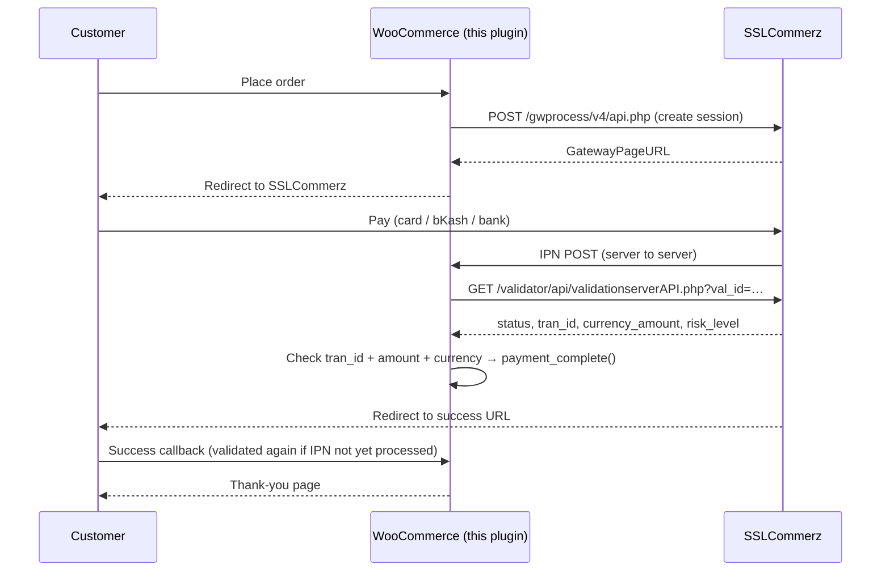

# WooCommerce BD Payment Gateway (SSLCommerz starter)

> ⚠️ **Starter / demo code.** Built by [Meraz.Pro](https://meraz.pro) to show a secure integration pattern. It is not a certified or officially supported SSLCommerz plugin. Review it, test it end to end in the **sandbox**, and get your live store approved before taking real payments.

A small WordPress plugin that adds an **SSLCommerz** hosted-payment gateway to WooCommerce. SSLCommerz covers Visa/Mastercard/Amex, bKash, Nagad, Rocket and internet banking in Bangladesh.

## Highlights

- **Hosted payment page:** customers pay on SSLCommerz, so card data never reaches or gets stored on your server
- **Sandbox/live toggle** with separate credentials in the WooCommerce settings (nothing hard-coded)
- **Server-side verification before "paid":** every success redirect or IPN is checked with the SSLCommerz **Order Validation API** (`validationserverAPI.php`), plus:
  - `status` is `VALID` / `VALIDATED`
  - `tran_id` matches the one stored on the order (timing-safe compare)
  - `currency_type` and `currency_amount` match the order currency and total
- **Risky payments** (`risk_level = 1`) go **on hold** instead of being completed
- **Idempotent:** the IPN and the browser redirect can both arrive without double-processing
- **IPN `verify_sign` check** as an extra, advisory signal (the validation API is the real gate)
- **HPOS compatible** (custom order tables declared). All order access goes through `WC_Order` CRUD
- **Logging** with `wc_get_logger()` (source `bdpg-sslcommerz`). Passwords and card data are never logged

## Payment flow



Endpoints follow the [SSLCommerz v4 developer docs](https://developer.sslcommerz.com/doc/v4/):

| Purpose | Sandbox | Live |
| --- | --- | --- |
| Create session | `https://sandbox.sslcommerz.com/gwprocess/v4/api.php` | `https://securepay.sslcommerz.com/gwprocess/v4/api.php` |
| Order validation | `https://sandbox.sslcommerz.com/validator/api/validationserverAPI.php` | `https://securepay.sslcommerz.com/validator/api/validationserverAPI.php` |

## Files

```
woocommerce-bd-payment-gateway.php           Bootstrap, HPOS/Blocks declarations, gateway registration
includes/class-bdpg-sslcommerz-api.php       SSLCommerz API client (session, validation, IPN hash)
includes/class-wc-gateway-bdpg-sslcommerz.php WooCommerce gateway, callbacks, verification
readme.txt                                   WordPress-style readme
```

## Install and test (sandbox first)

1. Create a sandbox store at <https://developer.sslcommerz.com/registration/>.
2. Copy this folder to `wp-content/plugins/` (or zip it and upload) and activate it. WooCommerce must be active.
3. Go to **WooCommerce → Settings → Payments → SSLCommerz (BD Payment Gateway)**:
   - Enable it, keep **Sandbox mode** on, and enter the sandbox Store ID and password
   - Turn on **Debug log** while testing
4. Make sure your site is reachable over HTTPS from the internet, because SSLCommerz must reach the IPN URL shown in the settings. You can also add that URL in the merchant panel.
5. Place a test order and pay with the sandbox test cards from the SSLCommerz docs. Check:
   - The order becomes *Processing* or *Completed*, with a "payment validated" note
   - **WooCommerce → Status → Logs → bdpg-sslcommerz**
   - Cancel and fail flows return to checkout with a notice
6. Go live: enter the live credentials, turn sandbox off, and run one small real payment.

SSLCommerz requires a minimum of 10.00 BDT per transaction and settles in BDT. Other currencies are converted by SSLCommerz.

## Block checkout

The plugin **declares itself incompatible with Cart & Checkout Blocks**, so WooCommerce warns you if your checkout page uses blocks. Use the classic checkout (a page with the `[woocommerce_checkout]` shortcode). Supporting blocks would need a small `Automattic\WooCommerce\Blocks\Payments\Integrations\AbstractPaymentMethodType` class plus a registered JS payment method. That's a natural next step.

## Not included (yet)

- Refunds through the SSLCommerz refund API
- EMI options and Easy Checkout (popup) mode
- Automated PHP tests (WordPress/WooCommerce test harness)

## License

MIT © Meraz.Pro. Need this set up or customised for your store? Visit [meraz.pro](https://meraz.pro) or email [merazulislam90@gmail.com](mailto:merazulislam90@gmail.com).
